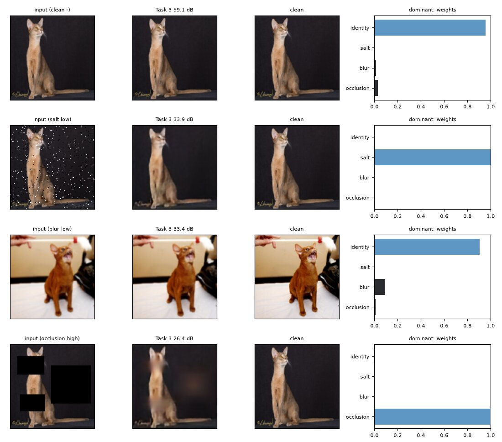
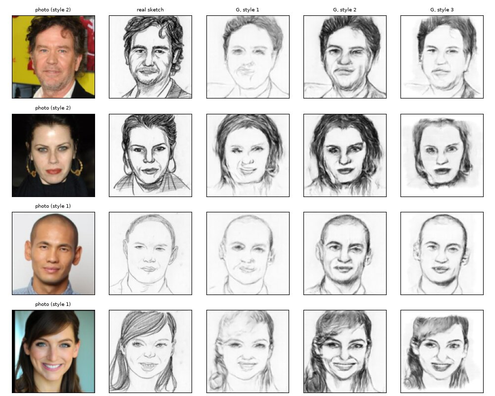

# Loupe

My first assignment for the Generative AI course at FAST-NUCES. There are four image models, and one web app (React + FastAPI, in Docker) that runs all of them:

1. **Universal restoration.** One convolutional autoencoder that fixes pet photos (Oxford-IIIT Pet, 128×128) damaged by salt-and-pepper noise, Gaussian blur or black boxes.
2. **Hard routing.** A small CNN works out which corruption it is, then sends the image to one of three specialist autoencoders.
3. **Soft mixture of experts.** A gate blends the three specialists with an "identity" branch that leaves the input alone.
4. **Face to sketch.** A pix2pix-style conditional GAN trained on FS2K that draws a face in one of three sketch styles.

Every hyperparameter search ran in Optuna and every training run is logged in MLflow. Both databases are in the repo. All seven models are exported to ONNX for the app.



## Results

Test set: 36,690 fixed corrupted pet images. Numbers are PSNR in dB, higher is better.

| Input | Do nothing | Universal AE | Hard routing | Soft MoE |
|---|---|---|---|---|
| Salt-and-pepper | 16.38 | 27.62 | 28.45 | **28.72** |
| Blur | 27.82 | 26.94 | 27.47 | **29.24** |
| Occlusion | 13.58 | 22.15 | **22.66** | 21.58 |
| Clean (should stay untouched) | 100 | 27.87 | 99.40 | 69.50 |

What I took away from this:

- The router's classifier gets 99.63% test accuracy (macro-F1 0.994), so hard routing beats the single autoencoder on every corruption, by 0.5 to 0.8 dB.
- The universal autoencoder tops out around 28 dB, even on clean images. Every output gets redrawn from a 4,096-number bottleneck, so fine texture is lost even where nothing was wrong.
- The soft MoE wins on blur because the gate learned to keep most of the original image. On mild blur the identity branch gets 0.82 of the weight. That makes it the only model that beats "do nothing" on mild blur (32.56 vs 32.34 dB).
- The same habit costs it about 1 dB on occlusion. On small boxes the gate keeps too much of the input, so the black box stays partly visible. The app fills the box afterwards to make up for this.

**Face to sketch** (1,046 FS2K test pairs, LPIPS, lower is better):

| Model | LPIPS | SSIM |
|---|---|---|
| Tuned cGAN | **0.207** | 0.525 |
| pix2pix defaults | 0.222 | 0.513 |
| L1 loss only | 0.435 | **0.563** |
| Canny edges | 0.535 | 0.316 |

The L1-only model has the best SSIM, but its outputs are grey smudges with no strokes. That's why I chose models by SSIM − LPIPS and not SSIM alone. The style switch clearly works: style 1 gives thin light lines, style 2 heavy dark strokes, style 3 softer shading.



On CPU each model takes about 3 ms per image (10.6 ms for the MoE, which runs every branch). The ONNX outputs match PyTorch to within 5e-6.

## Run the app

You need Docker with Compose.

```bash
./get_models.sh && docker compose up --build
```

`get_models.sh` downloads the seven ONNX models (214 MB) from the [`models-v1` release](https://github.com/lioncovehx/GenAI-Assignment1/releases/tag/models-v1) and checks their SHA-256 sums. If you're on Windows, run it in Git Bash or WSL.

- App: http://localhost:8080
- MLflow (read-only training records): http://localhost:5001

## What's where

| Folder | Contents |
|---|---|
| `common/` | Dataset loading, the corruptions, fixed val/test manifests, losses and metrics |
| `task1_universal_autoencoder/` … `task4_cgan_sketch/` | Model, training, Optuna search, evaluation and ONNX export for each task |
| `app/backend/` | FastAPI service that runs the ONNX models |
| `app/frontend/` | React + Tailwind frontend |
| `manifests/` | Fixed splits and corruption parameters, so every result can be reproduced exactly |
| `optuna/`, `mlflow.db` | All Optuna studies and MLflow runs |

## Reproduce the training

I trained everything on an RTX 5060 laptop GPU (8 GB) with Python 3.12 and PyTorch 2.14 (CUDA 13.0).

```bash
python3 -m venv .venv && source .venv/bin/activate
pip install -r requirements.txt
```

Oxford-IIIT Pet downloads itself the first time you run anything. FS2K you have to download from [its repo](https://github.com/DengPingFan/FS2K) and unpack into `data/FS2K/`.

The steps are the same for every task: Optuna search, final training with the best settings, one test evaluation, then ONNX export. The exact final settings are below.

<details>
<summary>Full commands</summary>

```bash
python -m common.test_common           # checks the corruption pipeline
python -m task4_cgan_sketch.data       # FS2K split and caches

# Task 1
python -m task1_universal_autoencoder.tune --trials 40
python -m task1_universal_autoencoder.train --epochs 60 --name final --cfg '{"lr": 0.0008783164913704277, "batch_size": 16, "latent_ch": 32, "base_ch": 64, "dropout": 0.04408982445617521, "alpha": 0.5415273983442785}'
python -m task1_universal_autoencoder.evaluate
python -m task1_universal_autoencoder.export_onnx

# Task 2
python -m task2_hard_routing.tune_classifier --trials 40
python -m task2_hard_routing.train_classifier --epochs 30 --name final --cfg '{"lr": 0.0022111083220645446, "batch_size": 16, "channels": "32-64-128-128-256", "dropout": 0.4374703991026736, "weight_decay": 3.875226456412055e-05}'
python -m task2_hard_routing.tune_specialists --trials 45
C='"lr": 0.0008853007303819069, "batch_size": 16, "latent_ch": 32, "base_ch": 64, "alpha": 0.49679882325945124'
python -m task2_hard_routing.train_specialist --type salt      --epochs 60 --name final_salt      --cfg "{$C, \"seed\": 1}"
python -m task2_hard_routing.train_specialist --type blur      --epochs 60 --name final_blur      --cfg "{$C, \"seed\": 2}"
python -m task2_hard_routing.train_specialist --type occlusion --epochs 60 --name final_occlusion --cfg "{$C, \"seed\": 3}"
python -m task2_hard_routing.evaluate
python -m task2_hard_routing.export_onnx

# Task 3 (needs Task 2's final checkpoints)
python -m task3_soft_moe.tune --trials 40
python -m task3_soft_moe.train --epochs 16 --name final --cfg '{"lr_joint": 4.347788604191704e-05, "tau": 1.1905534085753122, "lam_c": 0.0019692299730100006, "lam_b": 0.0006961085663064285, "alpha": 0.7718958710980289, "lr_gate": 0.0009204331007007203}'
python -m task3_soft_moe.evaluate
python -m task3_soft_moe.export_onnx

# Task 4
python -m task4_cgan_sketch.tune --trials 43
python -m task4_cgan_sketch.train --epochs 200 --name final --cfg '{"lr_G": 0.000252975786282591, "lr_D": 6.56628826226686e-05, "batch_size": 1, "base_ch": 48, "dropout": 0.3148348189782642, "emb_dim": 8, "lam_l1": 92.7541414559482}'
python -m task4_cgan_sketch.evaluate
python -m task4_cgan_sketch.export_onnx

# Browse the records
mlflow ui --backend-store-uri sqlite:///mlflow.db --port 5001
optuna-dashboard sqlite:///optuna/task1.db

# Check the backend against the training code
MODELS_DIR=models python app/backend/selftest.py
```

</details>

Checkpoints, figures and ONNX files go into each task's `outputs/` folder. Copy the ONNX files into `models/` if you want the app to serve your own models.
